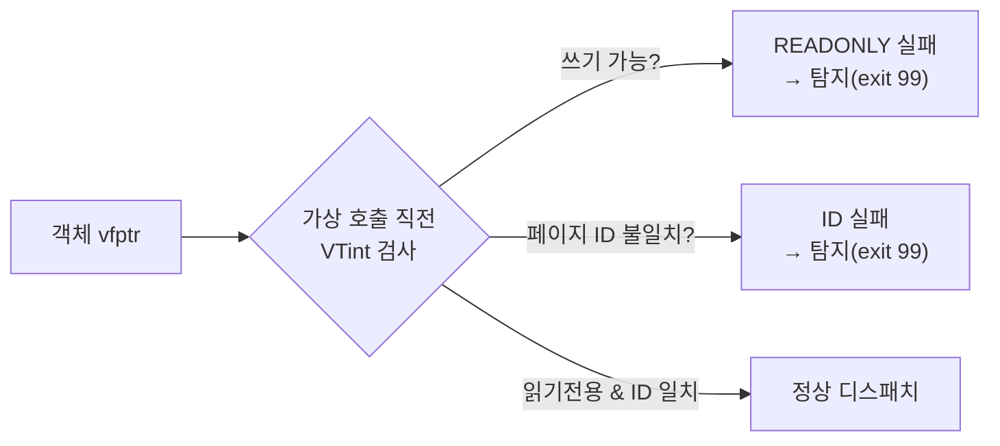
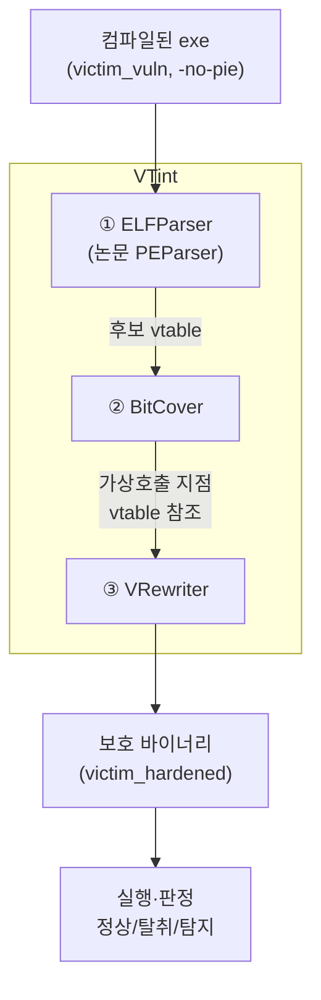

# VTint (ELF 적응 구현) — 가상 함수 테이블 무결성 보호

> 소프트웨어및시스템보안 · 논문 구현 프로젝트 · **3팀**
> 선정 논문: *VTint: Protecting Virtual Function Tables' Integrity* (NDSS'15)

원논문은 Windows **PE** 바이너리를 재작성하지만, 본 구현은 동일한 핵심 아이디어를
**Linux x86-64 ELF** 에 **실제 바이너리 재작성**으로 재현한다. 컴파일된 실행 파일(exe)을
입력으로 받아 `PEParser(ELFParser) → BitCover → VRewriter` 순서로 처리하여 **보호
바이너리** 를 만들고, 공격이 **차단되는지** 를 종료 코드로 판가름한다.

---

## 1. 빠른 시작

### Docker (권장 · 어느 PC 에서도 동일 재현)
```bash
./docker-run.sh
```
이미지(`vtint-env`)를 빌드하고 컨테이너 안에서 전체 데모를 실행하여 **보호 전/후 판정표** 를 출력한다.

### 로컬 리눅스(Ubuntu 22.04 기준)
```bash
# 의존성: g++, gcc, binutils, python3, pyelftools, capstone, lief
pip3 install pyelftools==0.31 capstone==5.0.1 lief==0.15.1
./run.sh
```

### 단계별 실행
```bash
bash tests/build.sh                                   # 취약 바이너리 컴파일 → out/victim_vuln
python3 tools/elfparser.py out/victim_vuln            # [1] ELF 파싱·후보 vtable (JSON)
python3 tools/bitcover.py out/victim_vuln             # [2] 디스어셈블·가상호출/참조 (JSON)
python3 tools/vrewriter.py out/victim_vuln out/victim_hardened   # [3] 재작성 → 보호 바이너리
python3 tools/vtint.py judge out/victim_hardened inject          # 한 번 실행·판정
```

### 테스트 실행 (자동 검증)
정상·위반·경계 3사례를 보호 전·후로 실행해 기대 결과와 맞는지 자동으로 확인한다.
```bash
./docker-test.sh        # Windows(PowerShell) 명령은 tests/README.md 참고
```
결과 비교표: `results/before_after.md` · 자세한 실행 방법과 테스트 구성: [`tests/README.md`](tests/README.md)

---

## 2. 공격 대상과 방어 원리

C++ 다형성 객체의 맨 앞 8바이트는 **vfptr**(가상 함수 테이블 포인터)다. 가상 함수 호출은
`vfptr → vtable[slot] → 간접 call` 로 디스패치된다. 공격자는 UAF/힙 오버플로로 **vfptr 을 덮어**
가짜 테이블을 가리키게 하여 제어 흐름을 탈취한다(vtable hijacking).

**핵심 관찰**: 정상 vtable 은 실행 중 절대 수정되지 않아 **읽기 전용** 영역에 있고, 주입된 가짜
vtable 은 반드시 **쓰기 가능** 영역(힙)에 있다. 따라서 가상 호출 **직전** 에 vtable 의 성질만
확인하면 공격을 가려낼 수 있다.

VTint 는 두 가지 검사를 삽입한다.
- **READONLY 검사** — vtable 이 쓰기 가능 영역이면 거부 → *vtable injection* 차단
- **ID 검사** — vtable 페이지 선두 8바이트가 주입한 랜덤 ID 와 다르면 거부 → 읽기 전용이지만
  vtable 이 아닌 데이터(.rodata) 악용(*vtable reuse*) 차단



---

## 3. 아키텍처 (exe → 3단계 → 보호 바이너리)



| 단계 | 파일 | 역할 | 사용 도구 |
|---|---|---|---|
| ① ELFParser | `tools/elfparser.py` | ELF 파싱, 읽기전용 섹션에서 **코드 포인터 배열 = 후보 vtable** 식별 | pyelftools |
| ② BitCover | `tools/bitcover.py` | 디스어셈블, **가상 호출 지점**(`mov base,[this]→mov slot,[base]→call slot`) 과 **vtable 참조**(생성자 vfptr 대입) 식별 | capstone |
| ③ VRewriter | `tools/vrewriter.py` | 읽기전용 `vtsec` 생성·vtable 이전·페이지 ID 기록, 참조 패치, 가상 호출에 **트램펄린 detour** 로 검사 삽입 | LIEF + freestanding 검사 루틴 |

### 재작성 결과(메모리 레이아웃)
```
원본 .rodata 의 vtable  ──이전──▶  vtsec (0x500000, r--p)
                                   ├ [0x500000] 8바이트 랜덤 ID   ← 페이지 선두
                                   ├ [0x500008] _ZTV7Derived 복사본
                                   └ [0x500030] _ZTV4Base   복사본
검사 코드 세그먼트        ──주입──▶  code (0x600000, r-x)
                                   ├ __vtint_check (freestanding, raw syscall)
                                   └ 가상 호출별 트램펄린
생성자의 vfptr 대입 immediate  ──패치──▶  새 vtsec 주소점
가상 호출 계측 윈도우         ──detour──▶  jmp → 트램펄린 → 검사 → 복귀
```

트램펄린은 가상 호출 직전 vtable base 를 `__vtint_check(vtbl)` 로 넘긴다. 검사 루틴은
`/proc/self/maps` 로 해당 매핑의 쓰기 가능 여부(READONLY)와 페이지 선두 ID(ID)를 확인하고,
실패 시 `VTINT DETECTED <검사> vfptr=0x... region=[..]` 를 출력하고 **종료 코드 99** 로 중단한다.

> 원리 애니메이션: [`docs/animation.html`](docs/animation.html) (브라우저로 열기)

---

## 4. 검증 사례 (11주차 고정 3종)

| 구분 | 입력 | 보호 전 | 보호 후 |
|---|---|---|---|
| **정상** | 오버플로 없음, Base*→Derived 가상호출 | `DERIVED RUN`, exit 0 | 동일 (`DERIVED RUN`, exit 0) |
| **위반(injection)** | 힙 가짜 vtable 주소로 vfptr 덮음 | `HIJACKED`, exit 66 | `VTINT DETECTED READONLY`, exit 99 |
| **경계(rodata reuse)** | .rodata 함수포인터 배열로 vfptr 덮음 | `HIJACKED`, exit 66 | `VTINT DETECTED ID`, exit 99 |

종료 코드: **0**=정상, **66**=제어 흐름 탈취(HIJACKED), **99**=VTint 탐지·차단.

데모 실행(`./run.sh`) 결과 3종 모두 기대와 일치한다. (탈가상화를 막기 위해 객체 생성은
`tests/factory.cpp` 로 분리하고 `-O0 -fno-devirtualize` 로 컴파일한다.)

---

## 5. 원논문 대비 차이 · 한계

| 항목 | 원논문(VTint) | 본 구현 |
|---|---|---|
| 대상 포맷 | Windows PE | Linux ELF (x86-64) |
| 읽기전용 검사 | SEH(쓰기 예외) | `/proc/self/maps` 매핑 권한 조회 |
| vtable 식별 | relocation 테이블 | 읽기전용 섹션의 코드 포인터 배열 스캔(+심볼) |
| 모듈 판별 | PEB 순회 | (미구현, fail-safe 생략) |

- **적용 범위**: 사용자가 만든 테스트 바이너리는 재현을 쉽게 하려고 `-no-pie -O0` 로 컴파일한다.
  임의 호출 지점 in-place 패치가 깨지기 쉬워, 트램펄린 detour 는 `mov base,[this]→mov slot,[base]`
  패턴이 명확한 바이너리를 대상으로 한다(VTint 역시 컴파일러 관용구에 의존).
- **한계**: 이미 존재하는 정상 vtable 을 가리키게 하는 **vtable reuse** 공격은 완전히 막지 못한다
  (논문과 동일 한계). fail-safe/멀티 모듈, PIE 는 향후 과제.

---

## 6. 파일 구성
```
vtint/
├─ Dockerfile            재현 환경(Ubuntu 22.04 + 도구)
├─ docker-run.sh         Docker 빌드+데모
├─ run.sh               로컬 데모
├─ tools/
│  ├─ elfparser.py      ① ELFParser
│  ├─ bitcover.py       ② BitCover
│  ├─ vrewriter.py      ③ VRewriter
│  └─ vtint.py          오케스트레이터(CLI·판정표)
├─ runtime/
│  ├─ vtint_check.c     주입되는 freestanding 검사 루틴
│  └─ check.ld          검사 블롭 링커 스크립트
├─ tests/
│  ├─ common.h / factory.cpp / victim.cpp   취약 예제
│  └─ build.sh
├─ docs/
│  ├─ architecture.md   상세 아키텍처·원리
│  └─ animation.html    원리 애니메이션
└─ out/                 산출물(victim_vuln, victim_hardened)
```

---

## 7. AI 활용 기록
- **요청**: 원논문(PE/SEH) 을 Linux ELF 로 옮기는 방법, `PEParser→BitCover→VRewriter` 각 단계의
  ELF 대응 설계, 검사 루틴(읽기전용·ID) 구현.
- **결과 확인**: 컴파일된 바이너리를 `readelf/objdump` 로 직접 실측하여 vtable 배치(.rodata),
  가상 호출 코드 패턴, 생성자 vtable 참조를 AI 설계와 대조했다.
- **채택·수정**: 3단계 구조와 검증 사례 3종 틀은 그대로 채택. 원논문의 SEH 읽기전용 검사는
  `/proc/self/maps` 기반으로, PE relocation 식별은 읽기전용 섹션 코드 포인터 스캔으로 대체했다.
- **어려웠던 점**: capstone 의 x86 operand 타입 상수(`X86_OP_MEM`=3 vs `CS_OP_MEM`=128) 불일치로
  가상 호출 탐지가 실패 → x86 전용 상수로 교정. LIEF 로 지정 VA 세그먼트 추가가 가능함을 실측 확인.
```
